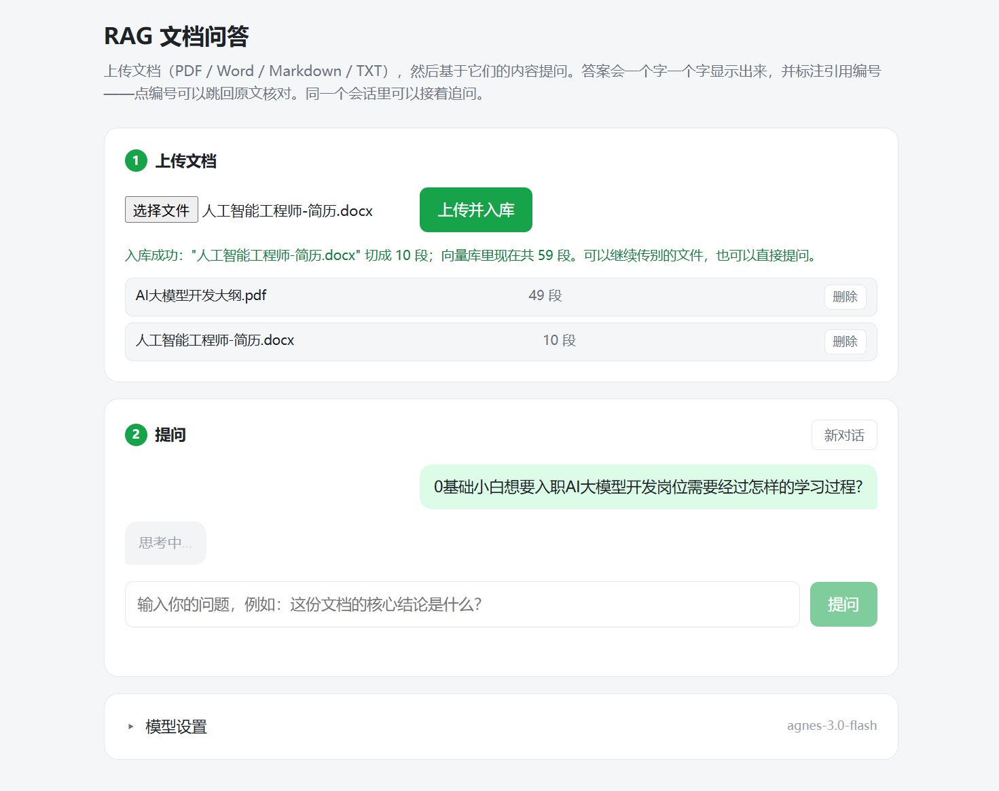
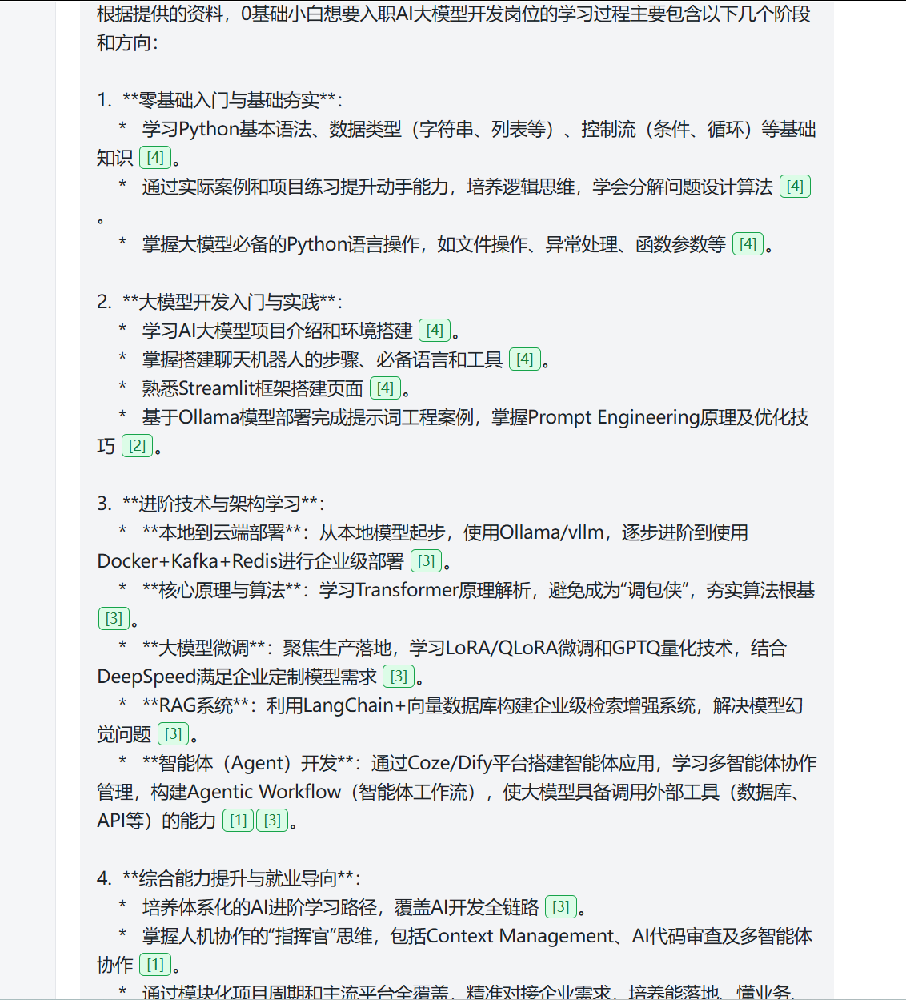
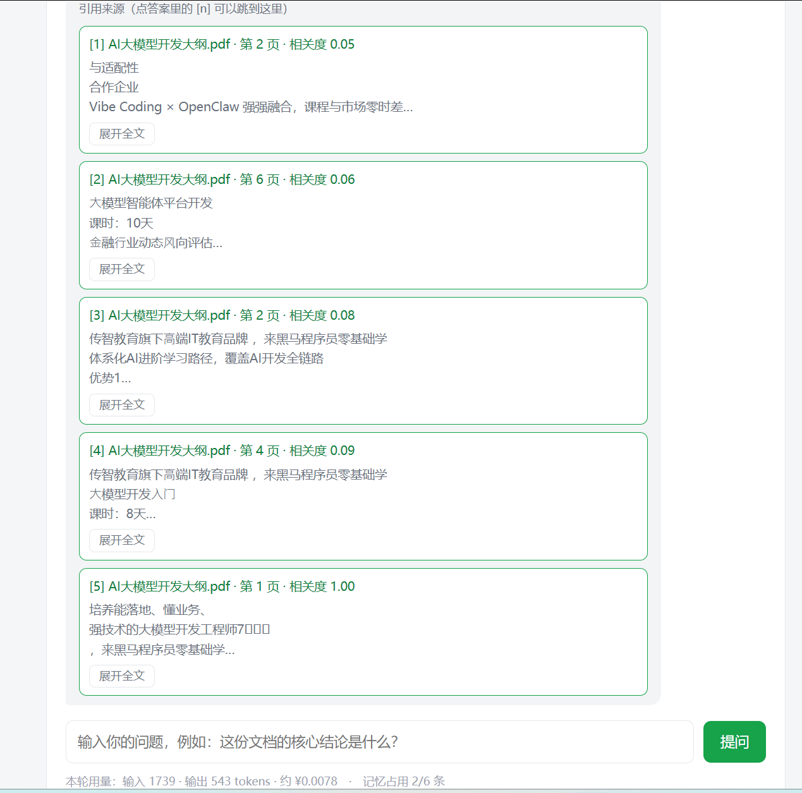
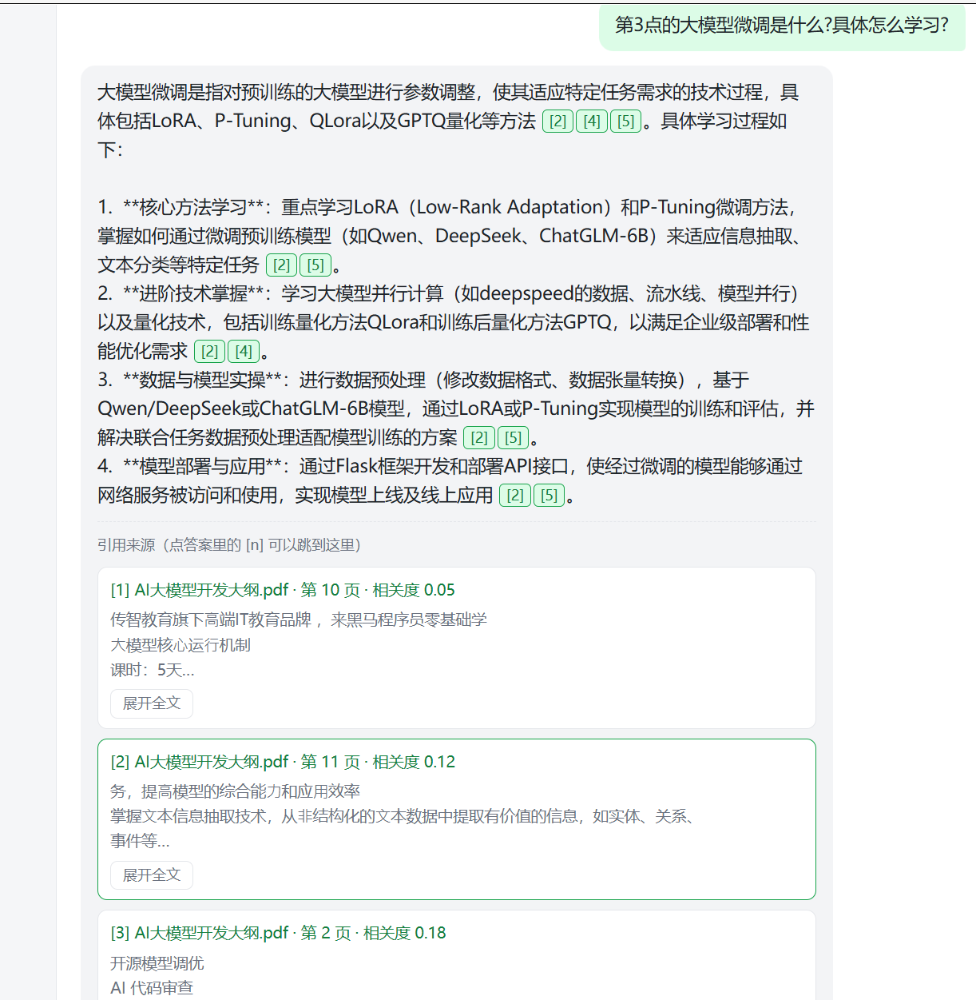
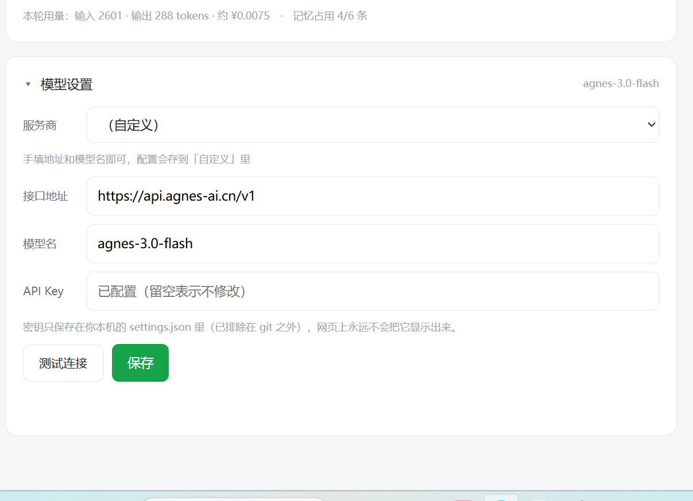

# RAG 文档问答系统

> 上传你的文档，直接提问。答案**逐字流式输出**，而且**每句话都标注引用编号 —— 点一下跳回原文核对**。

一个可本地运行的中文 RAG（检索增强生成）应用：把 PDF / Word / Markdown / TXT 丢进去，基于文件内容回答问题，而不是让大模型凭空编。


---

## 界面预览

### ① 上传文档 → 提问

支持四种格式；上传后自动解析、切块、入库，并列出知识库现状。提问后先显示「思考中…」，第一个字到达才切换成输出光标。



### ② 答案逐字流出，并标注引用编号

`[4]` `[2]` `[3]` 是可点标签 —— 点它直接跳到下面第几条来源。



### ③ 来源卡片：相关度 + 展开全文 + 被引用变绿

每条来源都给出**组内相关度**（看得出谁更相关），默认折叠成 3 行，可「展开全文」核对；被答案引用过的卡片边框变绿。



### ④ 多轮追问：接得上话

问「**第 3 点**的大模型微调是什么」时，全靠上一轮说了「第 3 点」是什么 —— 上下文记忆 + 查询改写共同生效。



### ⑤ 网页上切换大模型

智谱 GLM（永久免费）/ DeepSeek / 本地 Ollama / 任意兼容 OpenAI 接口的服务。**密钥只存本机，永不回传浏览器。**



---

## 它解决什么问题

大模型有三个天生的硬伤，RAG 正好一个不落全补上：

| 大模型的硬伤 | 说人话 | 本项目的做法 |
|---|---|---|
| **不知道你的资料** | 你们公司的制度、某型号参数、内部合同，它训练时压根没见过 | 提问时先把相关原文捞出来，塞进它的上下文 |
| **记忆停在过去** | 只知训练截止那天的事，昨天的文件不可能知道 | 资料库随时更新，每次都读最新的 |
| **会一本正经地编** | 这就是"幻觉"——不知道也硬答，编得还挺像 | 强制只照资料答，**每句话标出出处**；资料里没有就回答「资料中没有提到」 |

和传统搜索的区别：搜索给你 10 条链接让你自己翻；它**直接给答案，还附上出处**。

---

## 功能特性

### 检索：两路召回 + 精排

- **向量检索**（语义）：`BAAI/bge-small-zh-v1.5`，负责"意思像不像"——口语化提问、同义改写
- **关键词检索**（字面）：`jieba` 分词 + `BM25`，负责"字面对不对得上"——型号、条款编号、专有名词
- **RRF 融合**：把两路排名合成一个分数，**"两路都看好"比"一路特别看好"更可信**，重复结果自动去重
- **交叉编码器重排**：`BAAI/bge-reranker-base`，把问题和每段**拼在一起读**，逐条重新打分

> 为什么要两路？向量只看"意思像不像"，对**精确词**不敏感。你问「准入的财务门槛是多少」，纯向量检索很容易答「资料中没有提到」，加了关键词这一路才答得上来。

### 生成：可追溯

- **流式输出（SSE）**：逐字显示，不用干等；**先发来源、再发文字**，引用标签即时可点
- **引用溯源**：答案里的 `[3]` 是**可点标签**，点击跳到对应来源卡片；被引用过的卡片边框变绿
- **多轮对话记忆**：带角色的消息列表（system / user / assistant），追问「那第二点呢？」能接上话
- **查询改写**：检索前先用大模型把追问补成能独立检索的问句（「那第二点呢」→「供应商准入条件的第二点是什么」），**只为检索改写，答案仍按原话生成**
- **强守卫**：资料里没有的信息，强制回答「资料中没有提到」，不编
- **用量与花费**：每次回答后显示 token 消耗与金额估算，记忆占满时给出提醒

### 文档：结构感知

- **四种格式**：PDF / Word(.docx) / Markdown / TXT
- **按结构切块，而不是按字数硬切**：Markdown 按 `#` 层级、Word 认标题样式与手工标题、TXT 按空行段落
- **统一的位置说词**：PDF 给「第 3 页」，Word/Markdown 给「一、概述 > 1.2 安装」，TXT 给「第 3–7 段」——**上层代码不关心文件原本是什么格式**

---

## 检索流程

```
                      你的问题
                         │
                         ▼
            查询改写（有历史才做，无历史跳过）
            「那第二点呢？」→「供应商准入条件的第二点是什么？」
                         │
        ┌────────────────┴────────────────┐
        ▼                                 ▼
  向量检索（语义）                   关键词检索（字面）
  bge-small-zh-v1.5                  jieba + BM25
  粗捞 20 条                         粗捞 20 条
   "意思像不像"                       "字面对不对得上"
        └────────────────┬────────────────┘
                         ▼
              RRF 融合（手写，5 行数学）
        得分 = Σ  权重 / (60 + 名次)
        两路都看好的排前面，重复的自动去重
                         ▼
         交叉编码器重排（bge-reranker-base）
         问题 + 每段拼起来读，逐条重新打分
                         ▼
                  精选 Top 5
                         ▼
        拼提示词：按相关度【升序】摆放（近因效应，最相关的最靠近问题）
                  编号跟着摆放顺序走 → 编号最大的最相关
                         ▼
              大模型流式生成，边写边标引用 [1] [3]
                         ▼
              前端：逐字显示 + [n] 变成可点标签
```

---

## 架构

```
main.py              前台    —— 只做路由、错误翻译、启动预热
config.py            参数表  —— 所有旋钮，只放"名字"和"数字"，不放对象

rag/
  knowledge.py       档案室  —— 多格式解析 / 结构感知切块 / 向量库存取（不 import fastapi）
  retrieval.py       情报组  —— 双路召回 → RRF 融合 → 重排
  generation.py      文案    —— 查询改写 / 拼提示词 / 调大模型 / 重试
  session.py         会话记忆 —— 多轮对话历史存取
  settings.py        运行时设置 —— 各家服务商各存一份配置

index.html           前端    —— 引用标签 / 来源卡片 / SSE 流式 / 模型设置
```

**两条约定：**

1. **流水线模块互不 import**，统一由 `main.py` 串起来。
   所以「换掉检索方式」不会影响前端，「换掉大模型」也不会影响检索。
2. **错误在它该在的那一层说出来。**
   `knowledge.py` 抛 `KnowledgeError`，**它不认识 HTTP**；由 `main.py` 翻译成状态码。
   这样档案室将来也能被命令行工具直接复用。

> `session.py` / `settings.py` 是**工具**不是流水线工位，所以 `generation.py` 可以 import 它们——这是有意为之，不算破例。

---

## 快速开始

### 1. 安装依赖

```bash
python -m venv venv
venv\Scripts\activate          # Windows
pip install -r requirements.txt
```

> 国内下载模型慢的话，项目已自动设置 `HF_ENDPOINT=https://hf-mirror.com` 走镜像站。

### 2. 启动

```bash
uvicorn main:app --reload
```

首次启动会自动下载两个本地模型（向量模型约 90 MB，重排模型约 1 GB），
终端会打印进度条和「重排模型就绪」。**这一步只做一次**，之后走缓存、几秒启动。

> 重排模型下载失败也不影响使用：程序会自动降级为纯向量检索，服务照常可用。

### 3. 配置大模型

打开 <http://127.0.0.1:8000> ，展开页面最下方的「模型设置」，选一家、填 API Key、点「测试连接」→「保存」。

| 预设 | 地址 | 说明 |
|---|---|---|
| **智谱 GLM-4.7-Flash** | `open.bigmodel.cn/api/paas/v4` | **永久免费**，注册即用 |
| DeepSeek | `api.deepseek.com` | 付费；模型名只能是 `deepseek-flash` 或 `deepseek-v4-pro` |
| 本地 Ollama | `localhost:11434/v1` | 完全离线、不花钱；需先装 Ollama |
| 自定义 | 自己填 | 任何兼容 OpenAI 接口的服务 |

密钥只存在你本机的 `settings.json`（已 gitignore），**永不回传给浏览器**——
页面只显示"已配置 / 未配置"。

> 想用配置文件预设密钥，也可把 `secret.example.py` 复制成 `secret.py` 再填。

### 4. 使用

上传文档 → 提问 → 看答案里的 `[n]`，点它跳回原文核对。同一会话可以接着追问，点「新对话」清空记忆。

---

## 可调参数

全部集中在 `config.py`，改这里就等于调效果：

| 参数 | 默认 | 作用 |
|---|---|---|
| `CHUNK_SIZE` / `CHUNK_OVERLAP` | 500 / 50 | 每块多少字、相邻块重叠多少 |
| `SUPPORTED_EXTS` | `.pdf .docx .md .markdown .txt` | 受理哪些格式 |
| `DOCX_GUESS_HEADINGS` | True | 是否靠排版猜 Word 的手工标题 |
| `VECTOR_K` / `KEYWORD_K` | 20 / 20 | 两路各粗捞多少条 |
| `RERANK_TOP` | 5 | 重排后最终交给大模型几段 |
| `RRF_C` | 60 | RRF 阻尼常数：越大，名次差距被压得越平 |
| `RRF_WEIGHTS` | `[0.5, 0.5]` | 两路权重，顺序是 `[向量, 关键词]` |
| `RATIO_FLOOR` | 0.05 | 相关度显示的"地板"：最低那条也不显示 0.00 |
| `WEAK_MATCH_LOGIT` | 0.0 | 最高分低于它 → 提示"本次没有强相关资料" |
| `QUERY_REWRITE` | True | 是否启用查询改写 |
| `MAX_HISTORY_MESSAGES` | 6 | 每个会话记最近几条消息（约 3 轮） |
| `MAX_SESSIONS` | 200 | 最多同时记多少个会话（防内存无限涨） |

---

## 几个刻意的设计决策

**① 自己手写 RRF，不用 LangChain 的 `EnsembleRetriever`**
用现成的话，我们的召回器就得继承 LangChain 的 `BaseRetriever` 去实现一堆内部约定——
等于把"召回器长什么样"的所有权交给框架。RRF 只有 5 行数学，自己写反而公式看得见、
加第三路召回只是加一个类、少一层黑盒。**「形状」归自己所有，才好升级。**

**② 相关度显示：一个数字只表达一件事**
重排模型吐的是**无上下界**的 logit，而且实测"整组全为负"是常态（问题与文档不搭时）。
这个坑迭代了三次：

| 版本 | 做法 | 结果 |
|---|---|---|
| ① | 逐条套 sigmoid | -5 以下全压成 `0.000x`，5 条里 4 条显示 `0.00` |
| ② | 组内 min-max × `sigmoid(最高分)` | 整组全为负时被**整体压扁**成 `0.00~0.03`，照样看不出差别 |
| ③ **现行** | **拆开**：数字只给「组内相对位置」（永远铺满 0~1，最低从 `0.05` 起步）；「整体可不可信」交给一句黄色提示单独说 | `0.05 / 0.19 / 0.31 / 0.63 / 1.00` ✅ |

**教训**：想让一个数字同时表达"谁更相关"和"整体可不可信"，必然两头都做不好。

**③ 流式下的重试只能做在"第一个 token 之前"**
一旦已经有字发给用户，重来一遍会把内容**重复输出**。
所以策略是「只在吐出第一块之前重试」——用 `next(stream, None)` 先把第一块逼出来，
连接不上、密钥错、超时这些问题在这一步就能发现。这是流式的固有代价。

**④ 查询改写只为检索服务，答案仍按原话生成**
改写句会丢掉原话的语气和细节，而模型本来就能看到完整历史、不需要别人替它补全。
另外：**第一轮没有上文就跳过**（省一次调用），**改写失败一律退回原问题**（不让它拖垮回答）。

**⑤ 分块要"结构感知"，不能只按字数切**
中文文档的章节往往很短（几百字），按字数硬切会把一章切得七零八落，
"第 3 章讲什么"这种问题就再也答不准。所以按 `#` / Word 标题 / 空行切；
只有**一节太长**时才退回按字数切，且切出的每一块**继承同一节的位置**。

**⑥ 宁可漏认标题，也不能误认**
Word 里很多标题没用「标题 1」样式，而是手工打个 `▎` 再加粗。程序会去猜，
但条件定得很保守（短 + 不以句号结尾 + 带标题味符号）。
**因为漏认顶多退回按字数切；误认会把内容切得七零八落还造出一堆假章节，比不认更糟。**
另外 `flush()` 里有个兜底：**哪怕启发式猜错了，也绝不静默丢字**——错误退化成"切得碎"，而不是"数据损坏"。

---

## 已知局限

- **会话记忆存在进程内存**：`--reload` 重启会清空（换 SQLite 只需改 `session.py` 一个文件）
- **扫描件 PDF 读不出文字**：需要 OCR，目前会明确提示换一份能选中文字的
- **`faiss_db` 不能直接删单条向量**：删除文件是靠"重建整个库"实现的
- **重排只有一次机会**：如果重排模型没下下来，会静默降级为纯向量检索（页面顶部有提示条）

## 检索质量评估

`eval/run_eval.py` 是一个**纯本地、零 API 花费**的检索基准：把同一批问题分别喂给三种配置，看谁把"答案所在的那一段"排得更靠前。

```bash
python eval/run_eval.py        # 打对照表 + 分层归因
python eval/run_eval.py -v     # 再逐题列出命中排名
```

实测结果（**177 块语料 / 21 道标注题**，语料里刻意埋了 40 条"同前缀、只差四个数字"的编号条款做干扰）：

| 配置 | Hit@1 | Recall@5 | MRR |
|---|---|---|---|
| ① 只用向量（升级前） | 71% | 86% | 77% |
| ② 混合检索（+关键词 RRF，**不加重排**） | 67% | 76% | 71% |
| ③ 混合 + 重排（**线上现在**） | **95%** | **100%** | **98%** |
| | **+24%** | **+14%** | **+20%** |

按题型拆（Recall@5），**专有编号才是分水岭**：

| 题型 | ① 只用向量 | ② 混合 | ③ 混合+重排 |
|---|---|---|---|
| **专有编号**（5 题） | **40%** | **40%** | **100%** |
| 精确数字（10 题） | 100% | 100% | 100% |
| 语义理解（6 题） | 100% | 67% | 100% |

**归因**（正确段落有没有被这一层捞到）—— 把功劳分清楚：

| 层 | 命中 | 说明 |
|---|---|---|
| 向量粗召回 | 20/21 (95%) | 漏了 1 道 |
| 关键词粗召回 | 18/21 (86%) | |
| **融合候选池** | **21/21 (100%)** | **关键词补上了向量漏掉的那 1 道** |
| 最终前 5 | 21/21 (100%) | 排序由重排完成 |

三条结论：

- **专有编号是纯向量检索的软肋**：5 道编号题里它只对 2 道（40%），
  而完整管线全对（100%）—— 这正是本项目引入关键词检索的初衷。
- **关键词负责"召回"，重排负责"排序"**：向量单独粗召回只有 95%，
  两路融合后补到 100%（关键词的功劳）；但候选池里明明有正确段落，
  只按向量顺序取前 5 却只有 86% —— 把这 100% 变成前 5 命中，靠的是重排。
- **仍然反直觉：光加关键词、不加重排，比只用向量更差**（67% vs 71%）。
  RRF 会把关键词命中的段落往上提，没有重排纠正就会把本来正确的段落挤出去。
  **混合检索和重排是一套，不能只上半个。**

---

## 路线图

- [x] 多会话隔离 + 持久化（SQLite），重启不忘
- [x] 检索质量评估，量化"改动到底有没有变好"
- [ ] 更多格式：HTML、Excel、PPT
- [ ] 引用高亮到原句，而不只是定位到页/章节

---

## License

[MIT](LICENSE) © 2026 刘云飞